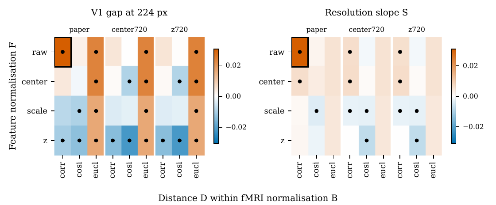

# ridge-readout

**Do untrained networks really beat trained ones at V1, or does it depend on how you measure?**

Paper: Analysis choices decide whether untrained networks beat trained ones at V1: a multiverse analysis of model–brain RSA arXiv:2611.15533, https://arxiv.org/abs/2611.15533

An earlier study (arXiv:2608.12408) found that an untrained convolutional network matches
human V1 (THINGS-fMRI) better than a backpropagation-trained one. This repository re-tests
that result with a pre-specified ridge readout and a multiverse of representational
similarity analyses (RSA), and holds everything needed to check the claims: the frozen
analysis plan, every amendment with its predictions, the code, the derived results and the
LaTeX sources of the paper.

## Findings at a glance

- **Ridge readout (pre-specified):** the untrained network scores *below* the trained one
  at every pooling grid (median r difference −0.043 at g = 4; 0 of 5 seeds positive).
- **RSA multiverse:** across 36 combinations of unit normalisation, distance measure and
  voxel normalisation (28 distinct analyses), the sign of the V1 contrast depends on the
  analysis: intervals above 0 in 5 and below 0 in 9 distinct analyses.
- **What raw RSA picks up:** raw correlation-distance RSA covaries with how strongly model
  and voxel patterns align with the unit-mean profile (Spearman 0.97 across our networks,
  0.79 across six ImageNet architectures); the advantage is absent from the component
  orthogonal to that profile.
- **Angular structure:** on the angular component of centred patterns, trained networks
  are ahead at V1 and at LOC.
- **Simple baselines:** a luminance-and-contrast feature bank scores above every network
  under the ridge readout (point estimates).

  
   
  <em>Untrained minus backpropagation at V1 in the 36 cells of the multiverse (left: gap at
  224 px; right: resolution slope). Orange: untrained ahead; blue: trained ahead; dots: 95%
  bootstrap CI excludes 0; framed: the convention of the earlier study.</em>

## Quick start

    git clone https://github.com/nilsleut/ridge-readout.git
    cd ridge-readout
    pip install -r requirements.txt
    python tests/test_phase2_controls.py        # 97 checks, no external data needed
    python scripts/export_macros.py             # regenerates every number in the paper from results/
    cd paper && pdflatex main && bibtex main && pdflatex main && pdflatex main

`export_macros.py` reads one value from the learning-rules-rsa repository
(`CROSSRUN_REPO`, see below); the full analyses need the external data listed further
down.

## Repository structure

    PREREGISTRATION.md, config.yaml, config.lock   frozen plan (config hash 206fa875cca5)
    amendments/   dated decisions and the predictions of each step
    reports/      step reports (historical record), ERRATA.md, RELEASE_AUDIT.md
    results/      measurement outputs (CSV; derived scores only, no data)
    src/ridge/    dual ridge, CV folds, grid pooling, config hash, paths
    src/vendor/   model loader and helpers from evaluation-resolution-rsa
    scripts/      analysis steps, macro and figure generators
    tests/        control suites (phase-2 controls, loader hardening, lower-edge gate)
    paper/        manuscript sources, claims ledger, correction notes
    docs/         figure images for this README (rendered from paper/figures/)
    PROVENANCE.md, CHANGES_FROM_ORIGIN.md   origin of imported files and all deviations
    DATA_MANIFEST.txt                       expected external files with sizes and sha256

## Installation

Python 3.11 (all results were produced with 3.11.9 on Windows, CPU only):

    python -m venv .venv
    .venv\Scripts\activate            # Linux/macOS: source .venv/bin/activate
    pip install -r requirements.txt

`requirements.txt` pins the versions used. The paper needs a LaTeX distribution with
`pdflatex` and `bibtex` (built with MiKTeX 25.4; packages: natbib, booktabs, amsmath,
graphicx, array, float, placeins, lmodern).

## External data (not in this repository)

No data, images or model weights are included. The analyses need:

- **THINGS-fMRI** (Hebart et al., 2023, eLife 12:e82580): single-trial responses
  `sub-0N_task-things_voxel-wise-responses.h5` and the voxel and stimulus metadata CSVs of
  subjects 1 to 3, from the THINGS-data release of the THINGS initiative
  (https://things-initiative.org). The data are subject to the terms of that release and
  are not redistributed here.
- **THINGS images** (`object_images`, one folder per concept), from the THINGS database of
  the same initiative, subject to its terms of use.
- **Network checkpoints**: the CIFAR-10 networks (five learning-rule conditions, five seeds)
  were trained in the earlier projects of the author (arXiv:2604.16875 and
  arXiv:2608.12408); they are not part of this repository. The ImageNet models are the
  torchvision weights.
- **Derived inputs** (`arm_b_out/` betas and `pilot_features/`): produced from the data
  above by `src/ridge/arm_b_betas.py` and the extraction scripts; `DATA_MANIFEST.txt` lists
  every expected file with size and sha256. Derived THINGS betas are not published.

## Environment variables

All machine-specific paths are read by `src/ridge/paths.py`, first from the process
environment and then from `.env.local` at the repository root (gitignored). Copy
`.env.example` to `.env.local` and set:

| Variable | Content |
|---|---|
| `THINGS_FMRI_DIR` | THINGS-fMRI responses and metadata CSVs |
| `THINGS_IMAGES_DIR` | THINGS `object_images` directory |
| `OUTPUTS_720_DIR` | `stim_order_sub-XX.txt` and `fmri_rdm_*.npy` of the 720 stimuli |
| `CKPT_DIR` | BN-fixed seed-0 checkpoints (default of the model loader) |
| `CKPT_V12_DIR` | the 30 v12 checkpoints (6 conditions × 5 seeds) |
| `CROSSRUN_REPO` | root of the learning-rules-rsa repository (git tag `arxiv-v4` is read) |
| `RIDGE_DATA_DIR` | directory containing `arm_b_out/` and `pilot_features/` |
| `BNFIX_SWEEP_CSV` | `results/bnfix_sweep.csv` of evaluation-resolution-rsa |
| `STEP5_GAP_DIR` | output directory for the step-5 GAP features (written) |

A missing variable stops the code with a message that names the variable and what it
should contain, for example
`RuntimeError: CKPT_DIR is not set (local checkpoint directory used as the load_model() default). Set it in the environment or in <repo>/.env.local; see .env.example.`

## Reproducing

Check the frozen configuration first:

    python -c "import sys; sys.path.insert(0,'src/ridge'); from config_hash import config_hash; print(config_hash())"
    # must print 206fa875cca5

(a) **Tests.** `python tests/test_phase2_controls.py` (97 checks) and
`python tests/test_loader_hardening.py` (41 checks); `python tests/suite_count.py` prints
both counts. `tests/test_lower_edge_gate.py` (2 checks) reads `RIDGE_DATA_DIR`. The phase-2
controls run without external data; the loader suite needs the checkpoints (`CKPT_DIR`)
and the lower-edge gate the derived inputs (`RIDGE_DATA_DIR`). Without them they stop with
the message of `src/ridge/paths.py` naming the missing variable.

(b) **Numbers in the paper.** `python scripts/export_macros.py` regenerates
`paper/numbers.tex` and `paper/numbers_map.csv` from `results/` (every number in the text
is one of these macros; the map gives source file, filter, column and rounding). It reads
only the CSVs in `results/`, except for the leave-one-subject-out bound, which it reads from
tag `arxiv-v4` of the learning-rules-rsa repository (`CROSSRUN_REPO`).

(c) **Paper.** In `paper/`: `pdflatex main`, `bibtex main`, `pdflatex main`,
`pdflatex main`. Figures are generated by `python scripts/make_figures.py` from `results/`
(two runs give byte-identical PDFs).

(d) **Analyses.** Each step's predictions are in `amendments/` and its report in
`reports/`; the scripts are grouped by step: `step2_*` (voxel set, lower edge), `step3_*`
(ridge against RSA), `step4_*`, `step5_*` (resolution), `step6_*`, `step7_*` (multiverse,
mean-profile alignment), `step8_*` (ImageNet models), `step9_separation.py` (norm and
angle), `step25_*` and `step28_*` (later controls), `prereg_*` and
`g2_equivalence_gate.py` (pre-specified primary analysis). Results are written to
`results/`, each CSV stamped with the config hash and the git commit.

**Runtime and hardware.** All ridge fits run on CPU (about 4 s per fit); the largest
block, the ridge robustness checks of step 25, took about 5.4 h. The stimulus-bootstrap
RSA analyses take minutes to hours on an 8-core CPU. Parts of the feature extraction ran
on a cloud GPU (`scripts/*_modal.py`, Modal); none of this is needed to reproduce the
numbers from `results/`.

## Analysis record

- `PREREGISTRATION.md` is a written analysis plan with a frozen configuration, fixed before
  the primary analysis. It was not publicly registered.
- `amendments/` holds every later decision and the predictions of each exploratory step.
  The order of events rests on the commit history: the commit timestamps, not the dates in
  file names, are authoritative.
- `paper/CLAIMS.md` lists every claim of the paper with its rule, result, macros, amendment
  commit and timestamp, and the failed predictions.
- `PROVENANCE.md` and `CHANGES_FROM_ORIGIN.md` document the origin of every imported file,
  the dating of the amendments and all deviations; corrections to earlier reports are in
  `reports/ERRATA.md`.

## License

Code: MIT (`LICENSE`). Paper text and figures (`paper/`): CC BY 4.0
(`LICENSE-CC-BY-4.0.md`). The THINGS data are not redistributed and remain subject to
their own terms.
